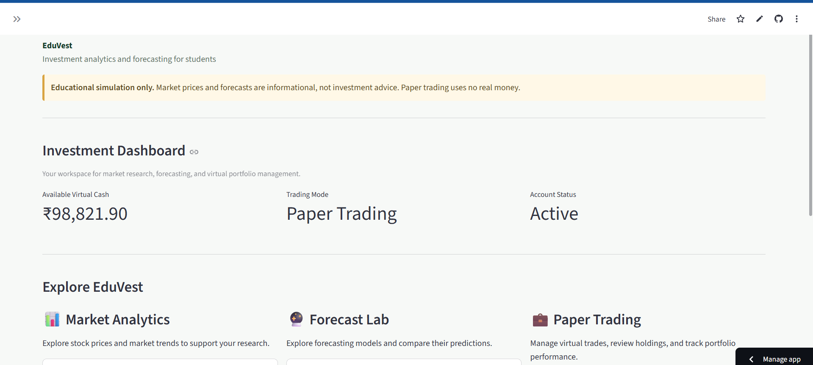
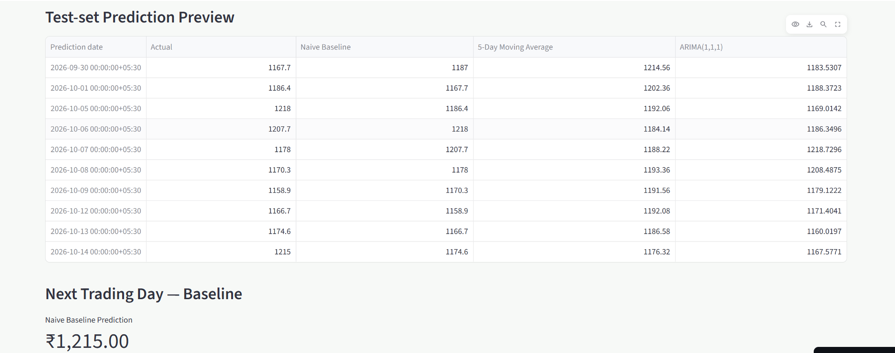
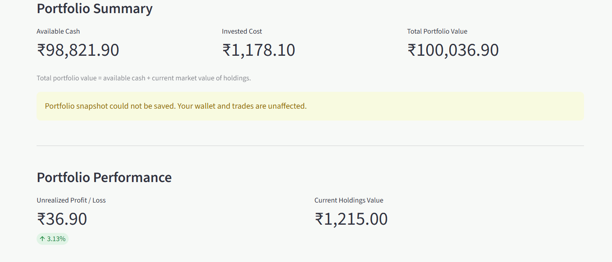

# EduVest — Investment Analytics & Paper Trading

EduVest is a student-focused investment analytics platform built to explore stock market data, study trends, experiment with forecasting, and practise investing using a virtual trading wallet.

> **Disclaimer:** EduVest is an educational project. Paper trading uses simulated funds and does not execute real-money trades or provide financial advice.

## Features

- **Market Data:** Explore supported stock market information.
- **Investment Analytics:** Visualise market data and stock trends.
- **Forecasting Lab:** Experiment with stock forecasting and model outputs.
- **Stock Explorer:** Browse and inspect supported stocks.
- **Virtual Trading Wallet:** Practise buying and selling with simulated funds.
- **Authentication:** User registration and login through Supabase.
- **Interactive Interface:** Explore data and analytics through Streamlit.

## Tech Stack

- **Language:** Python
- **Frontend / App Framework:** Streamlit
- **Data Analysis:** Pandas, NumPy
- **Visualisation:** Plotly
- **Market Data:** yfinance
- **Authentication / Backend:** Supabase
- **Machine Learning / Statistics:** Scikit-learn, SciPy, Statsmodels
- **Version Control:** Git and GitHub

## Application Screenshots

Screenshots of the running application will be added here.

## Application Screenshots

### Main Dashboard


### Forecasting and Analytics


### Virtual Trading Wallet



## Project Structure

```text
eduvest/
├── app.py
├── auth_page.py
├── auth_utils.py
├── analytics.py
├── forecast_lab.py
├── market_data.py
├── stock_explorer.py
├── wallet_page.py
├── requirements.txt
└── README.md
```

## Run Locally

### 1. Clone the repository

```bash
git clone https://github.com/sumit2010-apk/eduvest.git
cd eduvest
```

### 2. Create a virtual environment

```powershell
python -m venv .venv
.\.venv\Scripts\Activate.ps1
```

### 3. Install dependencies

```powershell
python -m pip install -r requirements.txt
```

### 4. Configure Supabase

Configure the required Supabase project URL and client key through your local environment configuration or Streamlit secrets.

Never commit `.env`, access tokens, passwords, or private keys.

### 5. Run the app

```powershell
streamlit run app.py
```

## Security

- Keep credentials out of source code.
- Never expose privileged Supabase service-role keys in client-facing code.
- Use simulated funds for paper trading.
- Treat forecasting results as experimental estimates, not guaranteed future prices.

## Future Improvements

- Expand automated testing.
- Evaluate forecasting models against appropriate baselines.
- Improve portfolio analytics and risk metrics.
- Enhance usability and accessibility.

## Author

**Sumit Singh**

GitHub: [@sumit2010-apk](https://github.com/sumit2010-apk)
